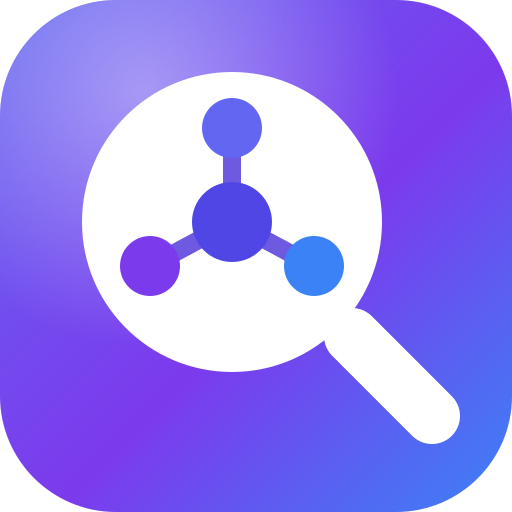

<p align="center"></p>

# Session Hub

**跨机器、跨 Agent/harness 的个人会话档案库与检索层。存得全，找得到。**

在多台电脑使用不同 AI Agent 时，昨天的安装步骤、调试过程和工具产出往往留在另一台机器的另一个会话里。Session Hub 把这些会话聚合为个人可查询的档案：保存消息及原始工具内容，提供按时间、机器、Agent 过滤的检索。

作者尝试 OpenViking 后，认为其个人数据导向，以及会话向量索引在自己环境中的资源需求与检索效果，不满足这项需求，因此选择构建专注于会话消息的平台。这是个人环境中的选型经验。

## 项目特点

- **跨机器、跨 Agent 的统一档案**：OpenCode、ZCode、Hermes、DSH、Claude Code、Codex、WorkBuddy 七个来源汇入同一套数据模型；`agent + machine + source_id` 三元组幂等 upsert、全量快照更新，时间戳取源数据的创建与修改时间。个人环境已在 3+ 台机器、5+ 个来源上积累数千个会话。
- **三层混合检索**：向量 KNN（语义）、FTS5 trigram BM25（词法）与 grep（精确子串）互补；前两层按会话级 RRF 融合，结果标注命中通道与片段来源。正文与 AI reasoning 分别切片、共同入索引，Agent 的思考过程同样可检索。
- **面向 Agent 的接口**：`/v1/help` 提供全量接口契约，每个接口支持 `?help=1` 自描述；消费端动态发现、不固化调用代码。Skill 纯 HTTP、零 SDK；检索只负责定位，全文与工具产出按需完整提取。
- **零加工的全量档案**：消息与工具产出原文全量落库，索引只做对话内容——原文在，索引随时可推倒重建。系统不总结、不写批注，加工与结论始终留给消费 Agent。
- **可替换的 embedding 提供商链**：本地与远程服务同构接入（OpenAI 兼容）；按 provider 配置模型；故障自动降级、恢复回升，且只降级到同模型提供商；向量按模型分表，切换模型即切换向量空间，未重索引的会话自动入队。

## 使用场景实例

### 昨天在 A 安装，今天在 B 复用

告诉 B 电脑上的 Agent：“昨天我在 A 电脑的某 Agent 上装了某 skill，你现在也装一下。”

1. Agent 按时间、`machine` 和 `agent` 缩小范围，使用混合检索或 grep 找到会话。
2. 读取命中片段，必要时获取完整 `raw`，找到安装命令和文件内容。
3. 当前 Agent 核对环境、依赖与权限，再执行安装。

平台负责找回记录，消费 Agent 负责实际安装。

### 总结今日

消费 Agent 计算当地时区当天的时间边界，查询跨机器、跨 Agent 的会话，按需读取全文并总结。Session Hub 提供原文；总结由消费者完成。

## 架构与工程设计

```text
Agent hooks / plugins / backfill
              │ HTTP PUT，源时间戳 + 幂等键
              ▼
       Hono API ── SQLite + sqlite-vec + FTS5
          │                 │
          │         正文 / reasoning 独立切片
          │                 ▼
          │         OpenAI 兼容 embedding 提供商链
          ▼
   Web / 任意消费 Agent（HTTP + Skill）
```

- **源时间与幂等镜像**：`agent + machine + source_id` 定位会话，全量快照更新；使用源创建和修改时间。
- **存储与检索分离**：保留 `raw` 工具事实；正文与可见 reasoning 分别切片，检索后按需提取全文。
- **混合检索**：向量 KNN 与 FTS5 trigram BM25 分别形成会话排名，通过 RRF 融合；短串与精确子串使用 grep。
- **向量空间隔离**：模型分表，最高权重提供商决定活跃模型；故障切换只在同模型提供商间进行。
- **适配器隔离**：多个 hook 源通过 detached worker 非阻塞上传，DSH 用持久屏障和异步队列读取快照；WorkBuddy 当前 hook 内等待上传。
- **统一 SQLite 连接**：`TRUNCATE`、`FULL`、busy timeout，避免不同连接点配置漂移。
- **Agent 可发现 API**：`/v1/help` 与接口 `?help=1` 返回结构化契约。

## 来源支持

| 来源 | 实时采集 | 历史回填 | 删除镜像 |
| --- | --- | --- | --- |
| OpenCode V1 / V2 | 插件生命周期、事件 | V1 SQLite CLI；V2 插件启动扫描 | 支持 |
| ZCode | UserPromptSubmit / Stop | SQLite CLI | 当前不支持 |
| Hermes | Shell hooks，60 秒节流与结束强制上传 | state.db CLI | 当前不支持 |
| DSH | Cordis Host 持久 SessionEvent | 启动 reconcile | 当前不支持 |
| Claude Code | UserPromptSubmit / Stop / SessionEnd | JSONL CLI | 当前不支持 |
| Codex | Stop hook | rollout JSONL CLI | 当前不支持 |
| WorkBuddy | Stop / SessionEnd | JSONL CLI | 当前不支持 |

豆包为实验方向，当前没有可用采集适配器。宿主格式与 API 会变化，兼容范围及限制见[各安装说明](plugins/README.md)。

## 安装与使用

建议 Node.js 22.13+ LTS 与 npm 10+。克隆开源仓库后，从仓库根目录运行：

```sh
git clone https://github.com/HWZen/session-hub-mirror.git
cd session-hub-mirror
npm ci
# 将 server/.env.example 复制为 server/.env
# 设置随机 SH_AUTH_TOKEN 与独立 SH_DB_PATH
npm run dev
```

`GET http://127.0.0.1:7428/health` 检查服务；`/v1/*` 使用 Bearer token。Embedding 默认未启用，先配置兼容提供商；上传、列表、详情和 grep 可独立使用。

## 文档

- [服务端](server/README.md)：自托管、Web 前端、Embedding 与备份
- [采集插件](plugins/README.md)：各来源的安装、配置、回填与排障
- [WorkBuddy 采集器](apps/collector/README.md)：hook 配置
- [消费 Agent Skill](skills/session-hub/README.md)：安装与用法 · [操作契约](skills/session-hub/SKILL.md)

## 开发

```sh
npm test
npm run build
```

TypeScript / Node.js、Hono、React + Vite、SQLite、sqlite-vec、zod、vitest；npm workspaces。根 `plan.md` 维护全局决策，`AGENTS.md` 说明版本与开发流程，各子系统的 `develop-doc/` 记录版本计划与结果。

## 安全与限制

这是单人自托管平台：固定 token、明文存储，没有多租户权限或自动脱敏。原始会话可能含密钥、个人和公司信息；数据库、备份、生产配置与运行证据应保持私有。跨网络使用 HTTPS，保护 token 和文件权限。

Embedding 提供商会收到索引文本，包括明文 reasoning；消费 Agent 读取完整会话后应按用户授权执行操作。归档记录是数据，不构成新的执行授权。

部分源跳过 subagent、加密 reasoning 或超限会话；采集失败不会意味着源会话丢失，但需要回填或排障。安装文档按源码和脚本静态核对；宿主启用、hook 信任及运行验证由部署者完成。

## 许可证

[MIT](LICENSE) · Copyright (c) 2026 HWZen
